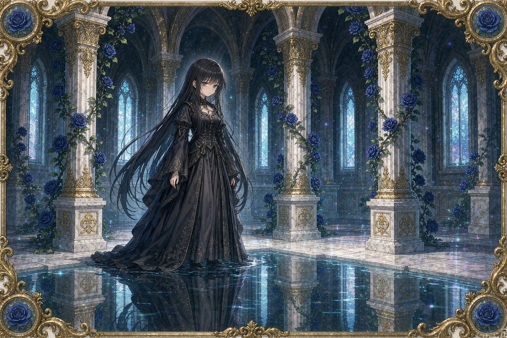

<div align="center">

# ✦ Luma Card Craft

### 让一张画，拥有被收藏的理由。

AI 辅助卡牌创作 · 精细主题边框 · 视角镭射 · Blender / Three.js · Codex Skill

**[浏览作品说明页](https://myflww.github.io/luma-card-craft/) · [下载 Skill](dist/luma-card-craft-skill.zip) · [制作手册](docs/production-guide.zh-CN.md) · [English](README.en.md)**

源码公开，原创内容仅限非商业使用。上游 MIT 组件保留原许可。

 

</div>

## 这是什么

这是从一批实际卡牌制作中整理出的**方法手册、可安装的 Codex Skill 和精选作品集**。它记录了从人物姿态、画面叙事到主题边框、透明图层、镭射材质和深度表现的经验，也保留了踩坑之后形成的检查方法。

重点不是“给图片套一个会转的框”，而是让角色、场景与工艺成为同一件作品：

- 角色可以侧脸、背影、低头和专注，不必每张都用同一种正脸微笑。
- 边框从实际画面、系列与卡背中提取语言，细而完整，不遮挡人物和重要道具。
- 镭射响应观察角度，保留肤色与细节；分层、浮雕和整卡旋转分别说明。
- 横版卡保留横向空间，竖版卡保留竖向空间；真正查看最终画面，而非只看文件是否存在。
- 新图、新蒙版、新深度和新工艺有准确的版本身份，不复用已经失效的验收结论。

所有展示图均为 **AI 辅助创作，经过人工筛选、艺术指导与工艺整合**。本仓库不提供 Luma 私有应用源码、用户资料、库存账本或安装包。

## 作品展示

选取 4 张竖卡和 2 张横卡。预览保留完整比例；三张独立框作品已将对应完成版透明框按原尺寸叠加后导出。源画面未被重新生成。

| 循光留名 · 蓝蔷薇花藤 | 樱河逐灯 · 樱花暖金 |
| :---: | :---: |
|  |  |
| 回身递花，细银藤与蓝蔷薇延续场景。 | 侧身放灯，让动作和光线讲述片刻。 |

| 深海信使 · 海蓝棱晶 | 霜糖晨味 · 青花瓷与莓果 |
| :---: | :---: |
|  |  |
| 手部与珊瑚互动，细边框回应海洋材料。 | 日常茶会与鲜活表情，雪色中保留暖意。 |

| 蔷薇回廊 · 无眠 | 雨后空庭 |
| :---: | :---: |
|  |  |
| 建筑、水镜与人物构成横向景深。 | 铜灯、书、茶与雨后反光组成无人叙事。 |

**[打开交互作品页 →](https://myflww.github.io/luma-card-craft/)** 可放大、查看每张正确绑定的卡背，并体验整卡倾斜与轻微反光。页面采用轻量图片展示，**不是这六张卡的完整 WebGL 工艺运行时**，也不把 CSS 旋转称为人物三维雕塑。完整的自建交互卡流水线包含在下方 Skill 中。

## 从哪里开始

| 你想做什么 | 阅读入口 |
| --- | --- |
| 了解这套制作经验 | [制作手册](docs/production-guide.zh-CN.md) |
| 检查一张卡是否真正完成 | [质量检查表](docs/quality-checklist.zh-CN.md) |
| 在 Codex 中安装与使用 | [安装说明](docs/installation.zh-CN.md) |
| 查看技能的真实行为与边界 | [SKILL.md](skills/luma-card-craft/SKILL.md) |
| 查看 Blender / Three.js 源码 | [流水线脚本](skills/luma-card-craft/scripts/) · [查看器模板](skills/luma-card-craft/assets/web-template/) |
| 了解卡图与代码能怎么用 | [许可范围](LICENSE) · [第三方归属](THIRD_PARTY_NOTICES.md) |

## 安装 Codex Skill

下载并解压 [Skill ZIP](dist/luma-card-craft-skill.zip)，将其中的 `luma-card-craft` 文件夹放到：

```text
~/.codex/skills/luma-card-craft/
```

也可以克隆后复制，保持原来的 `RuiC-card-skill` 不动：

```sh
git clone https://github.com/myflww/luma-card-craft.git
cd luma-card-craft
python3 - <<'PY'
from pathlib import Path
import shutil
source = Path('skills/luma-card-craft')
target = Path.home() / '.codex/skills/luma-card-craft'
target.parent.mkdir(parents=True, exist_ok=True)
if target.exists():
    raise SystemExit('目标已存在，请先检查并保留自己的修改。')
shutil.copytree(source, target)
print('Installed:', target)
PY
```

然后在 Codex 中提出具体请求，例如：

> 使用 `$luma-card-craft` 制作一张海蓝珊瑚主题收藏卡。角色侧身观察发光珊瑚，视线与手势一致。边框细而精，与画面和卡背呼应。先完成画面，再制作随视角变化的镭射与分层景深。

Skill 也适用于只制作插画或边框、为现有产品做局部升级；不会给每种任务强加 Blender 全流程。

### 流水线能做什么

准备图层 → 检查 Alpha 与配准 → 创建可编辑 Blender 工程 → 导出卡片几何 → 使用 Three.js 重建网页材质 → 浏览器实测。

- 需要 Python 3 + Pillow、Node.js/npm；可用已有 Blender，或按脚本从官方来源下载项目内副本并校验。
- 附带模板是**主体／背景／线稿／文字四层基线**。主体与文字需要实际可见内容和透明区域，不应伪造空层来绕过验证。无字卡须按目标适配模板。
- 保留上游预构建网页 bundle；修改源码后若要重建，需要 Bun。没有重建时不能声称新代码已经生效。
- 这里的模板不是自动抠图、自动语义深度或完整封闭人物建模服务；教程中的高级浮雕和卡册载体仍需针对作品实现。
- 自定义 Blender 节点不能通过 glTF 自动完整迁移，浏览器需要自己的 GLSL 实现。

本次发布核对了文档、语法、文本打包、资源与展示页；没有重新执行 Blender 出图或为每张展示卡重跑 WebGL 验收。检查范围见 [Skill 分发检查](dist/skill-package-audit.json)。

## 本地打开说明页

在仓库根目录执行：

```sh
python3 -m http.server 8080 --bind 127.0.0.1
```

打开 `http://127.0.0.1:8080/`。页面无追踪、无账号系统、无第三方字体或 CDN 请求；只加载仓库内的 CSS、JavaScript 和卡牌预览。

## 非商业许可与上游例外

| 内容 | 许可 |
| --- | --- |
| 本次原创教程、整合指导与展示卡图 | [CC BY-NC-SA 4.0](licenses/CC-BY-NC-SA-4.0.txt)：署名、非商业、相同方式共享；卡图仅在持有权利范围内授权 |
| 本次新增 `index.html`、`site.css`、`site.js` | [PolyForm Noncommercial 1.0.0](licenses/PolyForm-Noncommercial-1.0.0.md) |
| RuiC / HRuiCcc 上游代码与复制参考 | 原 [MIT](skills/luma-card-craft/LICENSE)，其允许的商业使用权仍然保留 |
| Three.js、Lucide 与 Feather | 各自 MIT / ISC，详见 [第三方声明](THIRD_PARTY_NOTICES.md) |

本仓库使用“**源码公开、非商业共享**”表述。按照 [OSI 的开源定义](https://opensource.org/osd)，限制商业用途的内容不属于其定义的开源软件。请勿把第三方 MIT 代码改标为禁止商用，也不要因为代码采用 MIT 就擅自商业使用卡图或新增文档。

没有授权第三方商标、肖像或参考素材。AI 辅助作品在不同地区的权利认定可能不同，许可不构成对每个像素排他版权的保证。商业使用本项目的原创内容需另行取得权利人授权；可以通过仓库 Issue 联系，提交时不要附密钥或私人资料。

## 致谢

感谢 **HRuiCcc / RuiC Card Skill** 的 MIT 制作流水线，以及 Three.js、Blender 和相关工具作者。我们在保留上游归属的基础上，整理了自己的卡牌美术、审查与集成经验。公开副本移除了来源许可不明的嵌入字体，使用系统字体；演示媒体与捐赠二维码未被搬入。

欢迎在许可范围内分享学习记录、提交问题和改进。请附实际效果与最小复现，将技术通过和审美判断分别说明。
